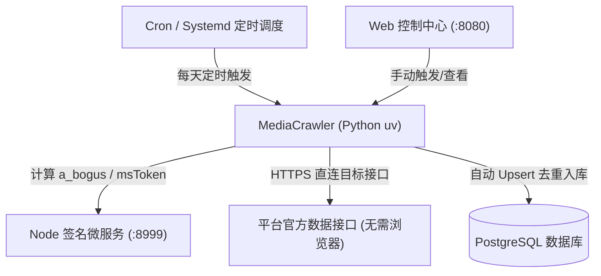

# MediaCrawler 部署与定时采集运维手册

本文档包含 **生产环境部署（服务器无人值守）**、**本地开发部署** 以及 **每日定时任务采集** 的完整说明与操作步骤。

---

精简版（Docker 容器化推荐）：

1. 确认服务器已运行 `wenhao-postgres` 数据库与 `wenhao-services` 外部网络；
2. 在 `.env` 配置 `DY_COOKIES`、`BILI_COOKIES`；
3. 启动服务：`docker compose up -d --build`（自动建表、种子化抖音/B站定时任务、拉起签名服务与 API）；
4. 用接口添加要跟踪的账号（写入 `douyin_creator` / `bilibili_up_info`，定时任务会自动同步）：

```bash
# 抖音 :8085
curl -X POST http://127.0.0.1:8085/api/douyin/creator/add \
  -H "Content-Type: application/json" \
  -d '{"url":"https://www.douyin.com/user/MS4wLjABAAAATJPY7LAlaa5X-c8uNdWkvz0jUGgpw4eeXIwu_8BhvqE","fetch_posts":true,"max_posts":10}'

# B站 :8086
curl -X POST http://127.0.0.1:8086/api/bilibili/creator/add \
  -H "Content-Type: application/json" \
  -d '{"url":"https://space.bilibili.com/20813884","fetch_posts":true,"max_posts":10}'
```

5. 检查日志与定时任务页：`http://127.0.0.1:8085/schedule-tasks`、`http://127.0.0.1:8086/schedule-tasks`；
6. **更新代码后重新生效**：`docker compose up -d --build`；仅改 Cookie/`.env` 用 `docker compose restart mediacrawler-dy mediacrawler-bili`。

---

精简版（PM2 宿主机运行）：

1. 配置数据库并初始化（`uv run main.py --init_db postgres`）；
2. 编译 WebUI 前端产物并配置环境变量；
3. PM2 启动服务（`pm2 start ecosystem.config.js`）；
4. 监听日志和数据是否定时更新；

---

## 目录

- [一、架构总览与选型建议](#一架构总览与选型建议)
- [二、基础环境准备](#二基础环境准备)
- [三、生产环境部署（Linux 服务器）](#三生产环境部署linux-服务器)
  - [3.1 环境变量与数据库配置](#31-环境变量与数据库配置)
  - [3.2 初始化 PostgreSQL 数据库](#32-初始化-postgresql-数据库)
  - [3.3 前端 WebUI 编译打包](#33-前端-webui-编译打包)
  - [3.4 进程守护管理（PM2 / Systemd）](#34-进程守护管理pm2--systemd)
  - [3.5 Docker 容器化一键部署（推荐）](#35-docker-容器化一键部署推荐)
    - [更新代码后如何重新部署](#4-更新代码后如何重新部署)
- [四、本地开发部署方式](#四本地开发部署方式)
  - [4.1 方式 A：纯 API + 签名服务模式（推荐）](#41-方式-a纯-api--签名服务模式推荐)
  - [4.2 方式 B：Chrome 9222 远程调试模式（登录/复杂反爬）](#42-方式-bchrome-9222-远程调试模式登录复杂反爬)
- [五、每日定时任务采集配置指南](#五每日定时任务采集配置指南)
  - [5.1 方案 A：Linux Crontab 生产级定时采集（最推荐、高稳定）](#51-方案-alinux-crontab-生产级定时采集最推荐高稳定)
  - [5.2 方案 B：Web 控制中心可视化定时任务（/schedule-tasks）](#52-方案-bweb-控制中心可视化定时任务schedule-tasks)
  - [5.3 方案 C：Systemd Timer 系统定时器](#53-方案-csystemd-timer-系统定时器)
- [六、运维监控与常用排查命令](#六运维监控与常用排查命令)

---

## 一、架构总览与选型建议

在服务器生产环境中，强烈建议使用 **「纯 API + 签名微服务 + PostgreSQL」** 架构：



### 生产环境与本地开发的核心差异：

1. **彻底去浏览器（免 Chrome 9222）**：服务器无需安装图形界面、Xvfb 或维持易崩溃的无头浏览器进程，内存占用从 `1.5GB+` 骤降至 `100MB` 以下。
2. **签名服务解耦（Node.js 微服务）**：通过高性能本地 HTTP 接口（`http://127.0.0.1:8999/sign`）计算加密参数，响应在毫秒级完成。
3. **数据直接入库（PostgreSQL）**：支持批量创作者采集自动去重、历史作品增量更新，便于与外部 BI/分析系统对接。

---

## 二、基础环境准备

### 1. 软件依赖清单

- **Python**: 3.11+，推荐使用 [uv](https://github.com/astral-sh/uv) 包管理器（速度极快且自带虚拟环境隔离）。
- **Node.js**: v18+（运行签名微服务及前端构建）。
- **PostgreSQL**: 14+（推荐 15/16/18，已验证兼容 Debian/macOS 各发行版）。

### 2. 工具链快速安装

```bash
# 1. 安装 uv
curl -LsSf https://astral.sh/uv/install.sh | sh
source $HOME/.cargo/env  # 或重启终端

# 2. 安装 Node.js (如已安装可跳过，推荐通过 nvm 或包管理器安装)
curl -fsSL https://deb.nodesource.com/setup_20.x | sudo -E bash -
sudo apt-get install -y nodejs   # CentOS: sudo yum install -y nodejs

# 3. 安装项目 Python 依赖
cd /path/to/MediaCrawler
uv sync
```

---

## 三、生产环境部署（Linux 服务器）

### 3.1 环境变量与数据库配置

在项目根目录下创建并编辑 `.env` 文件：

```bash
cp .env.example .env
vim .env
```

根据实际数据库信息填写 PostgreSQL 配置：

```ini
# PostgreSQL 数据库配置
POSTGRES_DB_HOST=127.0.0.1
POSTGRES_DB_PORT=5432
POSTGRES_DB_USER=postgres
POSTGRES_DB_PWD=your_postgres_password
POSTGRES_DB_NAME=media_crawler

# 签名微服务配置（默认无需修改）
SIGN_SERVICE_URL=http://127.0.0.1:8999/sign
```

并在 `config/base_config.py` 中确认默认存储为 `postgres`：

```python
SAVE_DATA_OPTION = "postgres"
```

---

### 3.2 初始化 PostgreSQL 数据库

> [!TIP]
> **如果使用 Docker 部署**：容器入口脚本已内置自动初始化机制（`AUTO_INIT_DB: "true"`），容器启动时会自动连入数据库检测并创建 `media_crawler` 库及所有数据表，**无需手动执行此步骤**（详见 [3.5 Docker 容器化一键部署](#35-docker-容器化一键部署推荐)）。若在宿主机直接通过 Python/PM2 运行，则需执行下方命令初始化：

执行自动化建表命令，系统将自动检测数据库是否存在，并创建全部表（含作品/评论/创作者，以及增长快照表 `douyin_creator_stats`、`douyin_aweme_stats`）：

```bash
uv run main.py --init_db postgres

# 验证快照表
psql -U postgres -d media_crawler -c "\dt douyin_*"
```

控制台输出：

```text
[init_table_schema] begin init postgres table schema ...
[init_db] Connecting to Postgres: host=127.0.0.1, port=5432, user=postgres, dbname=postgres
[init_table_schema] postgres table schema init successful
Database postgres initialized successfully.
```

---

### 3.3 前端 WebUI 编译打包

在生产环境部署时，需将 Web 控制中心前端代码编译生成静态资源：

```bash
cd webui
npm install
npm run build
cd ..
```

编译产物将自动放置在 `api/webui/` 下，由 FastAPI 后端统一代理托管，无需额外安装 Nginx 即可直接访问。

---

### 3.4 进程守护管理（PM2 / Systemd）

为确保服务开机自启、崩溃自动重启，建议使用 **PM2** 进行进程管理（或使用 Systemd）。

#### 方式一：使用 PM2 守护（最便捷）

全局安装 PM2：

```bash
npm install -g pm2
```

在项目根目录下创建 `ecosystem.config.js`：

```javascript
module.exports = {
  apps: [
    {
      name: "mediacrawler-sign-service",
      script: "services/sign_srv/server.js",
      cwd: "./",
      interpreter: "node",
      env: {
        SIGN_SRV_PORT: 8999,
      },
      restart_delay: 3000,
      max_restarts: 10,
    },
    {
      name: "mediacrawler-webui-api",
      script: "uv",
      args: "run uvicorn api.main:app --host 0.0.0.0 --port 8080",
      cwd: "./",
      interpreter: "none",
      restart_delay: 3000,
      max_restarts: 10,
    },
  ],
};
```

启动并持久化守护：

```bash
pm2 start ecosystem.config.js
pm2 save
pm2 startup  # 生成开机自启命令，按提示执行即可
```

#### 方式二：使用 Linux Systemd 守护（标准系统服务）

创建签名微服务 `/etc/systemd/system/mediacrawler-sign.service`：

```ini
[Unit]
Description=MediaCrawler Node Sign Service
After=network.target

[Service]
Type=simple
User=root
WorkingDirectory=/path/to/MediaCrawler
ExecStart=/usr/bin/node services/sign_srv/server.js
Restart=always
RestartSec=3

[Install]
WantedBy=multi-user.target
```

创建 API 后端服务 `/etc/systemd/system/mediacrawler-api.service`：

```ini
[Unit]
Description=MediaCrawler WebUI API Server
After=network.target mediacrawler-sign.service

[Service]
Type=simple
User=root
WorkingDirectory=/path/to/MediaCrawler
ExecStart=/root/.cargo/bin/uv run uvicorn api.main:app --host 0.0.0.0 --port 8080
Restart=always
RestartSec=3

[Install]
WantedBy=multi-user.target
```

启动服务：

```bash
sudo systemctl daemon-reload
sudo systemctl enable --now mediacrawler-sign
sudo systemctl enable --now mediacrawler-api
```

---

### 3.5 Docker 容器化一键部署（推荐）

如果服务器已安装 Docker，推荐使用 Docker Compose 进行生产部署。**无需在宿主机额外配置 Python 3.11、Node.js 20 或 uv 环境**，环境高度隔离，一键即可拉起全套采集服务。

#### 1. 前置网络与数据库要求
- 数据库复用服务器中已启动的 PostgreSQL 容器（容器名：`wenhao-postgres`，端口：`5432`）；
- 服务将自动加入已存在的 Docker 公共网络：`wenhao-services`；
- 无需手动建表，容器入口脚本内置了 `AUTO_INIT_DB: "true"`，启动时会自动连入数据库完成全量表结构初始化与迁移（**含抖音快照表**）。

#### 1.1 配置抖音自动定时任务（推荐写进 `.env`）

Docker 启动后会自动种子化一条抖音增长快照任务，无需再手动去 `/schedule-tasks` 新建。请在项目根目录 `.env` 中配置：

```bash
# 是否自动写入抖音定时任务（默认 true）
AUTO_SEED_DY_SCHEDULE=true
# 定时任务走纯 API（Docker 无 Chrome，必须为 true）
SCHEDULED_CRAWL_PURE_API=true
# 北京时间早中晚三段
DY_SCHEDULE_RUN_TIME=09:00,14:00,22:30
DY_SCHEDULE_MAX_PAGES=3
DY_SCHEDULE_SAVE_OPTION=postgres
DY_SCHEDULE_TASK_NAME=抖音增长快照(自动)
# 可选白名单；留空 = 自动读取 douyin_creator 全部账号（推荐）
DY_SCHEDULE_CREATOR_IDS=
DY_SCHEDULE_SYNC_FROM_DB=true
```

说明：
- **作者来源**：默认从 Postgres `douyin_creator.user_id` 读取；每次定时执行前也会再同步一次，新加账号会自动进入采集；
- `DY_SCHEDULE_CREATOR_IDS` **不是必填**，只在你想限制白名单时才写；
- 任务元数据保存在挂载目录 `./data/sqlite_tables.db`，容器重建不丢失；
- 采集结果写入 PostgreSQL；快照追加到 `douyin_creator_stats` / `douyin_aweme_stats`。

#### 1.2 配置 B站采集服务

`mediacrawler-bili` 与 `mediacrawler-dy` 使用同一镜像、同一个 PostgreSQL，数据目录和 API 端口独立。B站容器仅走 HTTP API：有效 Cookie 时使用登录权限；未配置 Cookie 时仍可采集公开视频，但受权限限制的接口可能失败。

```bash
# 必填：登录 B站后复制完整 Cookie（至少包含 SESSDATA）
BILI_COOKIES='SESSDATA=...; bili_jct=...; DedeUserID=...'

# 创作者模式：UID 或 space.bilibili.com 链接，逗号分隔
BILI_CREATOR_IDS=20813884,https://space.bilibili.com/434377496

# 可选：指定视频模式使用 BV 号或视频链接
BILI_SPECIFIED_IDS=BV1xx411c7mD
```

在 B站 WebUI（默认 `http://服务器IP:8086`）选择 `bili`、`creator` / `detail`、`postgres` 后启动采集；视频会按 `video_id` Upsert 到 `bilibili_video`，评论按 `comment_id` Upsert 到 `bilibili_video_comment`。

#### 2. 一键构建并启动
在项目根目录下执行：

```bash
docker compose up -d --build
```

> 若服务器上还是旧镜像、没有快照表：必须 `--build` 重新构建后再启动，仅 `restart` 不会带上新表结构代码。

#### 3. 查看容器状态与日志
```bash
# 查看容器运行状态（确认状态为 Up；抖音为 8085，B站为 8086，容器内均为 8080）
docker compose ps

# 查看实时运行日志（可观察到数据库自动建表与 API 启动流程）
docker compose logs -f mediacrawler-dy
docker compose logs -f mediacrawler-bili
```

> [!WARNING]
> **常见报错：Bind for 0.0.0.0:8080 failed: port is already allocated**
> 说明服务器宿主机上已有其他服务（如之前的 Uvicorn、Tomcat、Nginx 或其他容器）占用了 `8080` 端口。
> - **方案 A（已默认采用）**：抖音与 B站分别映射 **`8085`**（`${DY_APP_PORT:-8085}:8080`）和 **`8086`**（`${BILI_APP_PORT:-8086}:8080`），避开 8080 冲突。
> - **方案 B（继续使用 8080）**：排查并停用原占用进程：
>   ```bash
>   # 查看占用 8080 的进程
>   lsof -i :8080    # 或 netstat -tunlp | grep 8080
>   # 终止原进程或停止旧容器
>   kill -9 <PID>
>   ```

正常启动时，日志将包含以下内容：
```text
🚀 正在启动 MediaCrawler 生产容器服务...
📦 正在初始化 postgres 数据库表结构 (自动建表/迁移，含快照表)...
[init_db] Connecting to Postgres: host=wenhao-postgres, port=5432, ...
✅ 数据库表结构初始化/检查完成
   快照表: douyin_creator_stats=OK
   快照表: douyin_aweme_stats=OK
🔑 启动后台 Node.js 签名微服务 (http://127.0.0.1:8999)...
🌐 启动 MediaCrawler Web / API 核心服务 (0.0.0.0:8080)...
   AUTO_SEED_DY_SCHEDULE=true
   SCHEDULED_CRAWL_PURE_API=true
   DY_SCHEDULE_RUN_TIME=09:00,14:00,22:30
[ScheduledTaskService.ensure_default_douyin_schedule] created/updated task #...
INFO:     Application startup complete.
INFO:     Uvicorn running on http://0.0.0.0:8080 (Press CTRL+C to quit)
```

#### 3.1 验证快照表是否已创建

```bash
docker exec -it wenhao-postgres psql -U postgres -d media_crawler -c "\dt douyin_*"
# 期望至少包含：
# douyin_aweme / douyin_aweme_comment / douyin_aweme_stats
# douyin_creator / douyin_creator_stats

# 若仍缺少快照表，在应用容器内强制建表：
docker compose exec mediacrawler-dy uv run main.py --init_db postgres
```

#### 3.2 验证定时任务是否已自动添加

```bash
# API 查看
curl -s http://127.0.0.1:8085/api/scheduled-tasks

# Web 页面
open http://127.0.0.1:8085/schedule-tasks
# 应看到「抖音增长快照(自动)」，每日执行时间 09:00,14:00,22:30
```

#### 4. 更新代码后如何重新部署

业务代码（如 `api/`、`media_platform/`、`store/` 等）会打进 Docker 镜像，**改完代码后必须重新构建**，只 `restart` 不会生效。

**场景 A：更新了业务代码（推荐固定流程）**

```bash
cd /path/to/MediaCrawler

# 1）拉取或同步最新代码到服务器（按你自己的发布方式）
# git pull

# 2）重新构建镜像并后台启动（会替换旧容器）
docker compose up -d --build

# 3）确认新容器已起来
docker compose ps
docker compose logs -f mediacrawler-dy
docker compose logs -f mediacrawler-bili
```

说明：
- `up -d --build` = 重新 `build` 镜像 + 用新镜像启动/替换容器；
- 挂载目录 `./data/dy`、`./data/bili` 与外部 PostgreSQL 数据**不会丢失**；
- 接口分别访问：抖音 `http://127.0.0.1:8085`，B站 `http://127.0.0.1:8086`。

**场景 B：只改了 Cookie / `.env`（无需重新 build）**

宿主机的 `.env` 与 `config/base_config.py` 已通过只读 Volume 挂载进容器。修改后执行：

```bash
docker compose restart mediacrawler-dy mediacrawler-bili
```

即可秒级生效，无需 `build`。

| 变更内容 | 正确命令 | 是否需要 `--build` |
| :--- | :--- | :--- |
| `api/`、`media_platform/`、`store/`、`Dockerfile` 等业务代码 | `docker compose up -d --build` | 需要 |
| `config/base_config.py`（如 COOKIES）或 `.env` | `docker compose restart mediacrawler` | 不需要 |
| 停止并下线服务 | `docker compose down` | — |

> [!TIP]
> **记忆口诀**：改代码 → `up -d --build`；改 Cookie/配置 → `restart`。

#### 5. 常用维护与运维命令

| 操作 | 对应命令 | 说明 |
| :--- | :--- | :--- |
| **查看实时日志** | `docker compose logs -f mediacrawler` | 查看接口请求、爬虫运行与错误日志 |
| **重启采集服务** | `docker compose restart mediacrawler` | 仅配置/Cookie 变更后快速热重载 |
| **更新代码后重构** | `docker compose up -d --build` | 代码变更后重新打镜像并启动 |
| **停止并下线服务** | `docker compose down` | 停止并移除容器（挂载的数据与日志不会丢失） |

#### 6. 验证服务与调用接口
容器启动后，即可在宿主机或外部业务系统中调用添加账号接口。

**抖音（默认端口 8085 / `mediacrawler-dy`）**

```bash
curl -X POST http://127.0.0.1:8085/api/douyin/creator/add \
  -H "Content-Type: application/json" \
  -d '{
    "url": "https://www.douyin.com/user/MS4wLjABAAAATJPY7LAlaa5X-c8uNdWkvz0jUGgpw4eeXIwu_8BhvqE",
    "fetch_posts": true,
    "max_posts": 10
  }'
```

成功时写入 `douyin_creator` / `douyin_aweme`，并追加对应 `*_stats` 快照。

**B站（默认端口 8086 / `mediacrawler-bili`）**

```bash
# 仅添加 UP 主资料（入库 bilibili_up_info，并追加 bilibili_up_stats）
curl -X POST http://127.0.0.1:8086/api/bilibili/creator/add \
  -H "Content-Type: application/json" \
  -d '{
    "url": "https://space.bilibili.com/20813884"
  }'

# 也可用纯 UID
curl -X POST http://127.0.0.1:8086/api/bilibili/creator/add \
  -H "Content-Type: application/json" \
  -d '{
    "url": "20813884",
    "fetch_posts": true,
    "max_posts": 10
  }'

# 可选：请求体传入临时 Cookie（否则使用容器内 BILI_COOKIES / CRAWLER_COOKIES）
curl -X POST http://127.0.0.1:8086/api/bilibili/creator/add \
  -H "Content-Type: application/json" \
  -d '{
    "url": "https://space.bilibili.com/434377496",
    "fetch_posts": true,
    "max_posts": 5,
    "cookies": "SESSDATA=...; bili_jct=...; DedeUserID=..."
  }'
```

成功判定：
- HTTP `200`，`data.user_id` / `data.nickname` 有值；
- Postgres：`bilibili_up_info` 出现该 UID；`fetch_posts=true` 时 `bilibili_video` 有新增/更新；
- 定时任务会在下次执行前从 `bilibili_up_info` 自动同步作者列表（无需再改 `BILI_SCHEDULE_CREATOR_IDS`）。

定时任务到点后会按 `scheduled_slot`（morning/afternoon/evening）分层刷新互动数据；也可在各平台 `/schedule-tasks` 页面点「立即执行」做冒烟验证。

---

## 四、本地开发部署方式

### 4.1 方式 A：纯 API + 签名服务模式（推荐）

适合抖音等已支持纯 API 的平台，无需启动 Chrome。

1. **终端 1：启动签名微服务**

   ```bash
   node services/sign_srv/server.js
   # 输出：MediaCrawler sign service listening on http://127.0.0.1:8999
   ```

2. **终端 2：执行创作者数据采集**

   ```bash
   # 采集单个作者最新 3 页内容并存入 PostgreSQL
   uv run main.py --platform dy --type creator --max_pages 3 --pure_api true --save_data_option postgres --creator_id "MS4wLjABAAAAB92s1iYJ6Kr4B6RpP3zenR2DywmkuBBX-RKYLExuNHk"

   # 批量采集多个作者（以逗号隔开）
   uv run main.py --platform dy --type creator --max_pages 3 --pure_api true --save_data_option postgres --creator_id "MS4wLjABAAAAB92s1iYJ6Kr4B6RpP3zenR2DywmkuBBX-RKYLExuNHk,MS4wLjABAAAAqW8dJX9-mXgmeucLFQW9iPwKz8LHOXBnLzscBfG-YBGLIv_lWbdPa3PUfvl9-6Q5"
   ```

3. **终端 3（可选）：启动 Web 控制中心与查看器**

   ```bash
   uv run uvicorn api.main:app --port 8080 --reload
   ```

   - 控制中心首页：`http://127.0.0.1:8080/`
   - 数据浏览：`http://127.0.0.1:8080/sqlite-viewer`
   - 任务调度：`http://127.0.0.1:8080/schedule-tasks`

---

### 4.2 方式 B：Chrome 9222 远程调试模式（登录/复杂反爬）

用于小红书、B站等需扫码登录或依赖浏览器会话的平台。

1. **启动 Chrome 远程调试端口**：
   - **macOS**:
     ```bash
     /Applications/Google\ Chrome.app/Contents/MacOS/Google\ Chrome \
       --remote-debugging-port=9222 \
       --user-data-dir="$HOME/.chrome-automation"
     ```
   - **Windows**:
     ```bat
     chrome.exe --remote-debugging-port=9222 --user-data-dir="C:\chrome-automation"
     ```
   - 在弹出的 Chrome 中打开目标平台页面并登录账号。

2. **执行附着采集**：
   ```bash
   uv run main.py --platform dy --lt qrcode --type creator --creator_id "MS4wLjABAAAAB9..." --max_pages 3 --save_data_option postgres
   ```

---

## 五、每日定时任务采集配置指南

### 5.1 方案 A：Linux Crontab 生产级定时采集（最推荐、高稳定）

这是**生产环境服务器最稳健、零开销、不依赖任何 GUI/Web 界面的做法**。

#### 1. 编写采集执行脚本

在项目下创建 `scripts/daily_crawl.sh`：

```bash
#!/usr/bin/env bash
set -e

# 进入项目根目录
PROJECT_DIR="/path/to/MediaCrawler"
cd "$PROJECT_DIR"

# 导出环境变量
export PATH="/root/.cargo/bin:$PATH"

# 检查 8999 签名服务是否存活，未存活则自动拉起
if ! curl -s http://127.0.0.1:8999/health > /dev/null; then
    echo "[$(date)] 8999 签名服务未运行，正在启动..."
    nohup node services/sign_srv/server.js > /tmp/sign_srv.log 2>&1 &
    sleep 2
fi

echo "[$(date)] 开始执行每日创作者采集任务..."

# 要采集的创作者列表（多个以逗号隔开）
CREATOR_IDS="MS4wLjABAAAAB92s1iYJ6Kr4B6RpP3zenR2DywmkuBBX-RKYLExuNHk,MS4wLjABAAAAqW8dJX9-mXgmeucLFQW9iPwKz8LHOXBnLzscBfG-YBGLIv_lWbdPa3PUfvl9-6Q5"

# 采集时段：morning / afternoon / evening（对应北京时间 09:00 / 14:00 / 22:30）
# 可通过环境变量 SLOT 传入，例如：SLOT=evening ./scripts/daily_crawl.sh
SLOT="${SLOT:-morning}"

echo "[$(date)] 开始执行抖音采集任务 slot=$SLOT ..."

# 执行采集（纯 API 模式 + 生命周期分层快照）
uv run main.py \
    --platform dy \
    --type creator \
    --max_pages 3 \
    --pure_api true \
    --save_data_option postgres \
    --scheduled_slot "$SLOT" \
    --creator_id "$CREATOR_IDS"

echo "[$(date)] 采集任务完成 slot=$SLOT。"
```

赋予执行权限：

```bash
chmod +x scripts/daily_crawl.sh
```

#### 2. 配置 Crontab 定时规则（北京时间早中晚三段）

编辑定时任务：

```bash
crontab -e
```

抖音增长分析推荐三段采集（账号快照仅 morning；视频按生命周期分层）：

```cron
# 09:00 北京时间：账号快照 + 新视频发现 + 近7天视频快照
0 9 * * * SLOT=morning /path/to/MediaCrawler/scripts/daily_crawl.sh >> /var/log/mediacrawler_cron.log 2>&1

# 14:00 北京时间：新视频发现 + 近7天视频快照
0 14 * * * SLOT=afternoon /path/to/MediaCrawler/scripts/daily_crawl.sh >> /var/log/mediacrawler_cron.log 2>&1

# 22:30 北京时间：新视频发现 + 近7天/8~30天/长尾周采
30 22 * * * SLOT=evening /path/to/MediaCrawler/scripts/daily_crawl.sh >> /var/log/mediacrawler_cron.log 2>&1
```

快照表：`douyin_creator_stats`（涨粉）、`douyin_aweme_stats`（互动趋势）。主表仍保存最新态。

---

### 5.2 方案 B：Web 控制中心可视化定时任务（/schedule-tasks）

**Docker 部署默认已自动创建任务**「抖音增长快照(自动)」（见 §3.5.1），一般无需手工新建。本方案用于查看、改作者列表或临时「立即执行」。

1. **访问界面**：
   - Docker：`http://127.0.0.1:8085/schedule-tasks`
   - 本地：`http://127.0.0.1:8080/schedule-tasks`
2. **若需手工新建/调整**：
   - **任务名称**：如 `抖音增长快照(自动)`
   - **平台**：选择 `抖音`
   - **每日执行时间**：支持多时段，如 `09:00,14:00,22:30`
   - **作者最大页数**：如 `3`（用于新作品发现分页）
   - **保存方式**：选择 `PostgreSQL`（`postgres`）
   - **作者列表**：每行一个 Sec UID
   - 勾选 **任务启用**，点击保存
3. **运行保障说明**：
   - Docker 下 `SCHEDULED_CRAWL_PURE_API=true`，定时采集走纯 API，不依赖 Chrome 9222；
   - 抖音任务会下发 `scheduled_slot`（morning/afternoon/evening），按作品生命周期选片刷新快照；
   - 需保证容器内 8999 签名服务已启动（`docker-entrypoint.sh` 会自动拉起）。

---

### 5.3 方案 C：Systemd Timer 系统定时器

适用于纯 Linux 运维环境，替代 crontab 的现代方案。

1. 创建执行服务 `/etc/systemd/system/mediacrawler-daily.service`：

   ```ini
   [Unit]
   Description=MediaCrawler Daily Crawl Task
   After=network.target mediacrawler-sign.service

   [Service]
   Type=oneshot
   WorkingDirectory=/path/to/MediaCrawler
   ExecStart=/path/to/MediaCrawler/scripts/daily_crawl.sh
   ```

2. 创建定时器 `/etc/systemd/system/mediacrawler-daily.timer`：

   ```ini
   [Unit]
   Description=Run MediaCrawler daily at 09:00 AM

   [Timer]
   OnCalendar=*-*-* 09:00:00
   Persistent=true

   [Install]
   WantedBy=timers.target
   ```

3. 激活定时器：
   ```bash
   sudo systemctl daemon-reload
   sudo systemctl enable --now mediacrawler-daily.timer
   ```

---

## 六、运维监控与常用排查命令

### 1. 签名服务健康检查

```bash
curl -s http://127.0.0.1:8999/health
# 正常响应：{"status":"ok","service":"MediaCrawler-Sign-Service","douyin_loaded":true,"timestamp":...}
```

### 2. 测试签名计算输出

```bash
curl -X POST http://127.0.0.1:8999/sign \
     -H "Content-Type: application/json" \
     -d '{"url":"https://www.douyin.com/aweme/v1/web/aweme/post/?sec_user_id=test","user_agent":"Mozilla/5.0"}'
# 正常返回计算好的 a_bogus 与 msToken
```

### 3. 查看 PostgreSQL 采集入库数据

```bash
# 进入数据库查看作者表和作品表数据
psql -U postgres -d media_crawler -c "SELECT id, user_id, nickname, fans, videos_count FROM douyin_creator LIMIT 5;"
psql -U postgres -d media_crawler -c "SELECT id, aweme_id, title, liked_count, comment_count FROM douyin_aweme ORDER BY id DESC LIMIT 5;"
psql -U postgres -d media_crawler -c "SELECT id, user_id, follower_count, collected_at, scheduled_slot FROM douyin_creator_stats ORDER BY id DESC LIMIT 5;"
psql -U postgres -d media_crawler -c "SELECT id, aweme_id, liked_count, collected_at, scheduled_slot FROM douyin_aweme_stats ORDER BY id DESC LIMIT 5;"
```

### 4. 常见问题排查速查表

| 现象                           | 排查方向              | 解决方案                                                                                       |
| :----------------------------- | :-------------------- | :--------------------------------------------------------------------------------------------- |
| **8999 端口报错拒绝连接**      | Node 签名微服务未启动 | 执行 `node services/sign_srv/server.js` 或检查 PM2 状态 `pm2 status`                           |
| **PostgreSQL 密码认证失败**    | `.env` 环境变量未读取 | 确认 `.env` 中密码无误，已在 `config/db_config.py` 中载入 `load_dotenv()`                      |
| **爬取提示缺少某些字段**       | 接口字段风控或变更    | 检查返回 JSON 报文，更新数据映射                                                               |
| **重复采集是否会覆盖数据**     | 数据幂等性确认        | 创作者表与作品表已设计 Upsert 机制：**不存在则新增，已存在则自动更新点赞/评论/粉丝等最新数据** |
| **无头模式/纯 API 验证码拦截** | 触发平台高频风控      | 在 `config/base_config.py` 中提高 `CRAWL_INTERVAL`（如设为 2~3 秒）或配置代理 IP 池            |
