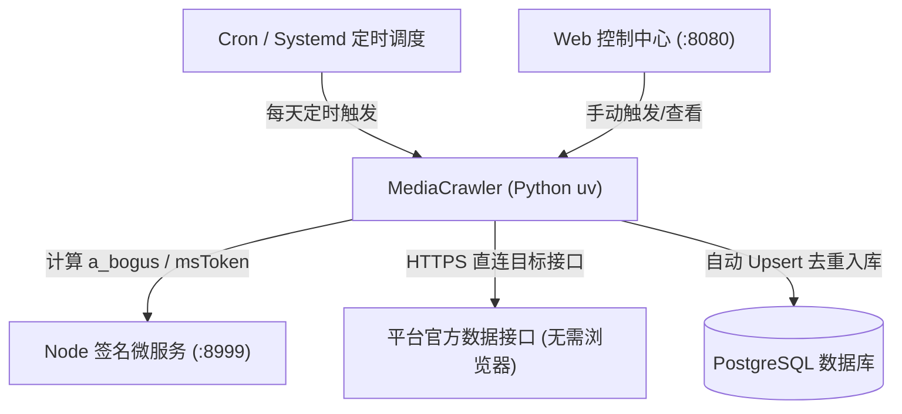

# MediaCrawler 部署与定时采集运维手册

本文档包含 **生产环境部署（服务器无人值守）**、**本地开发部署** 以及 **每日定时任务采集** 的完整说明与操作步骤。

---

## 目录
- [一、架构总览与选型建议](#一架构总览与选型建议)
- [二、基础环境准备](#二基础环境准备)
- [三、生产环境部署（Linux 服务器）](#三生产环境部署linux-服务器)
  - [3.1 环境变量与数据库配置](#31-环境变量与数据库配置)
  - [3.2 初始化 PostgreSQL 数据库](#32-初始化-postgresql-数据库)
  - [3.3 前端 WebUI 编译打包](#33-前端-webui-编译打包)
  - [3.4 进程守护管理（PM2 / Systemd）](#34-进程守护管理pm2--systemd)
- [四、本地开发部署方式](#四本地开发部署方式)
  - [4.1 方式 A：纯 API + 签名服务模式（推荐）](#41-方式-a纯-api--签名服务模式推荐)
  - [4.2 方式 B：Chrome 9222 远程调试模式（登录/复杂反爬）](#42-方式-bchrome-9222-远程调试模式登录复杂反爬)
- [五、每日定时任务采集配置指南](#五每日定时任务采集配置指南)
  - [5.1 方案 A：Linux Crontab 生产级定时采集（最推荐、高稳定）](#51-方案-alinux-crontab-生产级定时采集最推荐高稳定)
  - [5.2 方案 B：Web 控制中心可视化定时任务（/schedule-tasks）](#52-方案-bweb-控制中心可视化定时任务schedule-tasks)
  - [5.3 方案 C：Systemd Timer 系统定时器](#53-方案-csystemd-timer-系统定时器)
- [六、运维监控与常用排查命令](#六运维监控与常用排查命令)

---

## 一、架构总览与选型建议

在服务器生产环境中，强烈建议使用 **「纯 API + 签名微服务 + PostgreSQL」** 架构：



### 生产环境与本地开发的核心差异：
1. **彻底去浏览器（免 Chrome 9222）**：服务器无需安装图形界面、Xvfb 或维持易崩溃的无头浏览器进程，内存占用从 `1.5GB+` 骤降至 `100MB` 以下。
2. **签名服务解耦（Node.js 微服务）**：通过高性能本地 HTTP 接口（`http://127.0.0.1:8999/sign`）计算加密参数，响应在毫秒级完成。
3. **数据直接入库（PostgreSQL）**：支持批量创作者采集自动去重、历史作品增量更新，便于与外部 BI/分析系统对接。

---

## 二、基础环境准备

### 1. 软件依赖清单
- **Python**: 3.11+，推荐使用 [uv](https://github.com/astral-sh/uv) 包管理器（速度极快且自带虚拟环境隔离）。
- **Node.js**: v18+（运行签名微服务及前端构建）。
- **PostgreSQL**: 14+（推荐 15/16/18，已验证兼容 Debian/macOS 各发行版）。

### 2. 工具链快速安装
```bash
# 1. 安装 uv
curl -LsSf https://astral.sh/uv/install.sh | sh
source $HOME/.cargo/env  # 或重启终端

# 2. 安装 Node.js (如已安装可跳过，推荐通过 nvm 或包管理器安装)
curl -fsSL https://deb.nodesource.com/setup_20.x | sudo -E bash -
sudo apt-get install -y nodejs   # CentOS: sudo yum install -y nodejs

# 3. 安装项目 Python 依赖
cd /path/to/MediaCrawler
uv sync
```

---

## 三、生产环境部署（Linux 服务器）

### 3.1 环境变量与数据库配置
在项目根目录下创建并编辑 `.env` 文件：
```bash
cp .env.example .env
vim .env
```
根据实际数据库信息填写 PostgreSQL 配置：
```ini
# PostgreSQL 数据库配置
POSTGRES_DB_HOST=127.0.0.1
POSTGRES_DB_PORT=5432
POSTGRES_DB_USER=postgres
POSTGRES_DB_PWD=your_postgres_password
POSTGRES_DB_NAME=media_crawler

# 签名微服务配置（默认无需修改）
SIGN_SERVICE_URL=http://127.0.0.1:8999/sign
```

并在 `config/base_config.py` 中确认默认存储为 `postgres`：
```python
SAVE_DATA_OPTION = "postgres"
```

---

### 3.2 初始化 PostgreSQL 数据库
执行自动化建表命令，系统将自动检测数据库是否存在，并创建全部 29 张表（包含作品表、评论表以及规范命名的创作者表 `douyin_creator` 等）：
```bash
uv run main.py --init_db postgres
```
控制台输出：
```text
[init_table_schema] begin init postgres table schema ...
[init_db] Connecting to Postgres: host=127.0.0.1, port=5432, user=postgres, dbname=postgres
[init_table_schema] postgres table schema init successful
Database postgres initialized successfully.
```

---

### 3.3 前端 WebUI 编译打包
在生产环境部署时，需将 Web 控制中心前端代码编译生成静态资源：
```bash
cd webui
npm install
npm run build
cd ..
```
编译产物将自动放置在 `api/webui/` 下，由 FastAPI 后端统一代理托管，无需额外安装 Nginx 即可直接访问。

---

### 3.4 进程守护管理（PM2 / Systemd）

为确保服务开机自启、崩溃自动重启，建议使用 **PM2** 进行进程管理（或使用 Systemd）。

#### 方式一：使用 PM2 守护（最便捷）
全局安装 PM2：
```bash
npm install -g pm2
```

在项目根目录下创建 `ecosystem.config.js`：
```javascript
module.exports = {
  apps: [
    {
      name: "mediacrawler-sign-service",
      script: "services/sign_srv/server.js",
      cwd: "./",
      interpreter: "node",
      env: {
        SIGN_SRV_PORT: 8999,
      },
      restart_delay: 3000,
      max_restarts: 10,
    },
    {
      name: "mediacrawler-webui-api",
      script: "uv",
      args: "run uvicorn api.main:app --host 0.0.0.0 --port 8080",
      cwd: "./",
      restart_delay: 3000,
      max_restarts: 10,
    },
  ],
};
```

启动并持久化守护：
```bash
pm2 start ecosystem.config.js
pm2 save
pm2 startup  # 生成开机自启命令，按提示执行即可
```

#### 方式二：使用 Linux Systemd 守护（标准系统服务）
创建签名微服务 `/etc/systemd/system/mediacrawler-sign.service`：
```ini
[Unit]
Description=MediaCrawler Node Sign Service
After=network.target

[Service]
Type=simple
User=root
WorkingDirectory=/path/to/MediaCrawler
ExecStart=/usr/bin/node services/sign_srv/server.js
Restart=always
RestartSec=3

[Install]
WantedBy=multi-user.target
```

创建 API 后端服务 `/etc/systemd/system/mediacrawler-api.service`：
```ini
[Unit]
Description=MediaCrawler WebUI API Server
After=network.target mediacrawler-sign.service

[Service]
Type=simple
User=root
WorkingDirectory=/path/to/MediaCrawler
ExecStart=/root/.cargo/bin/uv run uvicorn api.main:app --host 0.0.0.0 --port 8080
Restart=always
RestartSec=3

[Install]
WantedBy=multi-user.target
```

启动服务：
```bash
sudo systemctl daemon-reload
sudo systemctl enable --now mediacrawler-sign
sudo systemctl enable --now mediacrawler-api
```

---

## 四、本地开发部署方式

### 4.1 方式 A：纯 API + 签名服务模式（推荐）
适合抖音等已支持纯 API 的平台，无需启动 Chrome。

1. **终端 1：启动签名微服务**
   ```bash
   node services/sign_srv/server.js
   # 输出：MediaCrawler sign service listening on http://127.0.0.1:8999
   ```

2. **终端 2：执行创作者数据采集**
   ```bash
   # 采集单个作者最新 3 页内容并存入 PostgreSQL
   uv run main.py --platform dy --type creator --max_pages 3 --pure_api true --save_data_option postgres --creator_id "MS4wLjABAAAAB92s1iYJ6Kr4B6RpP3zenR2DywmkuBBX-RKYLExuNHk"

   # 批量采集多个作者（以逗号隔开）
   uv run main.py --platform dy --type creator --max_pages 3 --pure_api true --save_data_option postgres --creator_id "MS4wLjABAAAAB92s1iYJ6Kr4B6RpP3zenR2DywmkuBBX-RKYLExuNHk,MS4wLjABAAAAqW8dJX9-mXgmeucLFQW9iPwKz8LHOXBnLzscBfG-YBGLIv_lWbdPa3PUfvl9-6Q5"
   ```

3. **终端 3（可选）：启动 Web 控制中心与查看器**
   ```bash
   uv run uvicorn api.main:app --port 8080 --reload
   ```
   - 控制中心首页：`http://127.0.0.1:8080/`
   - 数据浏览：`http://127.0.0.1:8080/sqlite-viewer`
   - 任务调度：`http://127.0.0.1:8080/schedule-tasks`

---

### 4.2 方式 B：Chrome 9222 远程调试模式（登录/复杂反爬）
用于小红书、B站等需扫码登录或依赖浏览器会话的平台。

1. **启动 Chrome 远程调试端口**：
   - **macOS**:
     ```bash
     /Applications/Google\ Chrome.app/Contents/MacOS/Google\ Chrome \
       --remote-debugging-port=9222 \
       --user-data-dir="$HOME/.chrome-automation"
     ```
   - **Windows**:
     ```bat
     chrome.exe --remote-debugging-port=9222 --user-data-dir="C:\chrome-automation"
     ```
   - 在弹出的 Chrome 中打开目标平台页面并登录账号。

2. **执行附着采集**：
   ```bash
   uv run main.py --platform dy --lt qrcode --type creator --creator_id "MS4wLjABAAAAB9..." --max_pages 3 --save_data_option postgres
   ```

---

## 五、每日定时任务采集配置指南

### 5.1 方案 A：Linux Crontab 生产级定时采集（最推荐、高稳定）

这是**生产环境服务器最稳健、零开销、不依赖任何 GUI/Web 界面的做法**。

#### 1. 编写采集执行脚本
在项目下创建 `scripts/daily_crawl.sh`：
```bash
#!/usr/bin/env bash
set -e

# 进入项目根目录
PROJECT_DIR="/path/to/MediaCrawler"
cd "$PROJECT_DIR"

# 导出环境变量
export PATH="/root/.cargo/bin:$PATH"

# 检查 8999 签名服务是否存活，未存活则自动拉起
if ! curl -s http://127.0.0.1:8999/health > /dev/null; then
    echo "[$(date)] 8999 签名服务未运行，正在启动..."
    nohup node services/sign_srv/server.js > /tmp/sign_srv.log 2>&1 &
    sleep 2
fi

echo "[$(date)] 开始执行每日创作者采集任务..."

# 要采集的创作者列表（多个以逗号隔开）
CREATOR_IDS="MS4wLjABAAAAB92s1iYJ6Kr4B6RpP3zenR2DywmkuBBX-RKYLExuNHk,MS4wLjABAAAAqW8dJX9-mXgmeucLFQW9iPwKz8LHOXBnLzscBfG-YBGLIv_lWbdPa3PUfvl9-6Q5"

# 执行采集（纯 API 模式，最大 3 页，直接存入 PostgreSQL）
uv run main.py \
    --platform dy \
    --type creator \
    --max_pages 3 \
    --pure_api true \
    --save_data_option postgres \
    --creator_id "$CREATOR_IDS"

echo "[$(date)] 每日采集任务完成。"
```

赋予执行权限：
```bash
chmod +x scripts/daily_crawl.sh
```

#### 2. 配置 Crontab 定时规则
编辑定时任务：
```bash
crontab -e
```
添加定时规则（例如每天早上 08:30 自动执行）：
```cron
30 8 * * * /path/to/MediaCrawler/scripts/daily_crawl.sh >> /var/log/mediacrawler_cron.log 2>&1
```

---

### 5.2 方案 B：Web 控制中心可视化定时任务（/schedule-tasks）

如果您希望在前端页面中查看和调整每日定时任务：

1. **访问界面**：
   打开浏览器访问 [http://127.0.0.1:8080/schedule-tasks](http://127.0.0.1:8080/schedule-tasks)。
2. **填写任务参数**：
   - **任务名称**：如 `抖音科技博主日采`
   - **平台**：选择 `抖音`
   - **每日执行时间**：设置时间，如 `09:00`
   - **作者最大页数**：如 `3`
   - **保存方式**：选择 `PostgreSQL`（对应数据库选项 `db` 或在配置中指定）
   - **作者列表**：每行输入一个博主的 Sec UID。
   - 勾选 **任务启用**，点击保存。
3. **运行保障说明**：
   - 调度系统会计算每天的下次运行时间 `next_run_at`，到点自动将任务推入队列串行调度；
   - 如使用纯 API 模式，需确保后台 8999 签名服务已启动。

---

### 5.3 方案 C：Systemd Timer 系统定时器
适用于纯 Linux 运维环境，替代 crontab 的现代方案。

1. 创建执行服务 `/etc/systemd/system/mediacrawler-daily.service`：
   ```ini
   [Unit]
   Description=MediaCrawler Daily Crawl Task
   After=network.target mediacrawler-sign.service

   [Service]
   Type=oneshot
   WorkingDirectory=/path/to/MediaCrawler
   ExecStart=/path/to/MediaCrawler/scripts/daily_crawl.sh
   ```

2. 创建定时器 `/etc/systemd/system/mediacrawler-daily.timer`：
   ```ini
   [Unit]
   Description=Run MediaCrawler daily at 09:00 AM

   [Timer]
   OnCalendar=*-*-* 09:00:00
   Persistent=true

   [Install]
   WantedBy=timers.target
   ```

3. 激活定时器：
   ```bash
   sudo systemctl daemon-reload
   sudo systemctl enable --now mediacrawler-daily.timer
   ```

---

## 六、运维监控与常用排查命令

### 1. 签名服务健康检查
```bash
curl -s http://127.0.0.1:8999/health
# 正常响应：{"status":"ok","service":"MediaCrawler-Sign-Service","douyin_loaded":true,"timestamp":...}
```

### 2. 测试签名计算输出
```bash
curl -X POST http://127.0.0.1:8999/sign \
     -H "Content-Type: application/json" \
     -d '{"url":"https://www.douyin.com/aweme/v1/web/aweme/post/?sec_user_id=test","user_agent":"Mozilla/5.0"}'
# 正常返回计算好的 a_bogus 与 msToken
```

### 3. 查看 PostgreSQL 采集入库数据
```bash
# 进入数据库查看作者表和作品表数据
psql -U postgres -d media_crawler -c "SELECT id, user_id, nickname, fans, videos_count FROM douyin_creator LIMIT 5;"
psql -U postgres -d media_crawler -c "SELECT id, aweme_id, title, liked_count, comment_count FROM douyin_aweme ORDER BY id DESC LIMIT 5;"
```

### 4. 常见问题排查速查表

| 现象 | 排查方向 | 解决方案 |
| :--- | :--- | :--- |
| **8999 端口报错拒绝连接** | Node 签名微服务未启动 | 执行 `node services/sign_srv/server.js` 或检查 PM2 状态 `pm2 status` |
| **PostgreSQL 密码认证失败** | `.env` 环境变量未读取 | 确认 `.env` 中密码无误，已在 `config/db_config.py` 中载入 `load_dotenv()` |
| **爬取提示缺少某些字段** | 接口字段风控或变更 | 检查返回 JSON 报文，更新数据映射 |
| **重复采集是否会覆盖数据** | 数据幂等性确认 | 创作者表与作品表已设计 Upsert 机制：**不存在则新增，已存在则自动更新点赞/评论/粉丝等最新数据** |
| **无头模式/纯 API 验证码拦截** | 触发平台高频风控 | 在 `config/base_config.py` 中提高 `CRAWL_INTERVAL`（如设为 2~3 秒）或配置代理 IP 池 |

